# ประเภทศัตรู — archewa

มี **14 ประเภท: ศัตรูที่สุ่มเกิด 13 ประเภท และบอส 1 ประเภท** ภาพในตารางเป็นสไปรต์ที่เกมใช้จริง รายละเอียดอ้างอิงพฤติกรรมในโค้ดปัจจุบัน

[กลับ README](README.md)

## แต่ละตัวทำอะไร

จำนวนฆ่าด้านล่างใช้ `Spawner.NormalKills` ซึ่งนับศัตรูที่ไม่ใช่บอส เกณฑ์ปลดล็อกหมายถึงเริ่มมีสิทธิ์สุ่มเกิด ไม่ใช่เกิดทันทีเมื่อถึงจำนวนนั้น กลุ่มพิเศษใช้ตัวจับเวลาแยกจากกลุ่มปกติ

| ภาพ | Enemy Type | เริ่มสุ่ม / กลุ่ม | พฤติกรรม | วิธีรับมือ |
| --- | --- | --- | --- | --- |
| 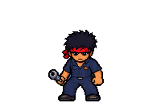 | **Chaser** | 0 ปกติ | วิ่งเข้าประชิดและง้างก่อนตี ใช้คิวโจมตีร่วมกันเพื่อลดการรุมตีพร้อมกัน | หลบให้พ้นระยะตอนง้าง หรือ Parry แล้วสวน |
| 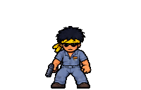 | **Shooter** | 0 พิเศษ | รักษาระยะ เลเซอร์เตือนก่อนยิงสองนัดต่อชุด หยุดเดินระหว่างเล็งและยิง | ขยับออกจากแนวหลังล็อกเป้า หรือสะท้อนกระสุน |
| 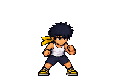 | **Sprinter** | 8 ปกติ | สายประชิดที่วิ่งเร็วและง้างสั้นกว่า Chaser | อย่าปล่อยเข้าประชิดพร้อมฝูง ใช้ Dash เปลี่ยนตำแหน่ง |
|  | **Zigzagger** | 15 ปกติ | เพิ่มการเคลื่อนที่ส่ายด้านข้างระหว่างเข้าหาผู้เล่น | อ่านตำแหน่งจริงก่อนฟัน อย่าเล็งตามแนวตรงอย่างเดียว |
| 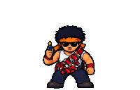 | **Bomber** | 20 ปกติ | เข้าระยะแล้วหยุดจุดชนวน 0.85 วินาที ก่อนระเบิดรอบตัว รัศมี 3.4 หน่วย | กำจัดก่อนชนวนหมด หรือรีบออกนอกวงระเบิด |
| 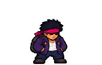 | **Splitter** | 25 ปกติ | เมื่อถูกฆ่าจะปล่อย Sprinter สองตัวใกล้ตำแหน่งเดิม | เผื่อพื้นที่หนีและเตรียมรับศัตรูเพิ่มหลังฆ่าตัวแรก |
| 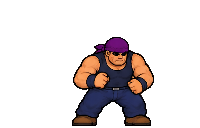 | **Brute** | 30 พิเศษ | ตัวใหญ่ เดินช้า เลือดพื้นฐาน 15 มีท่าง้างจับระยะประชิด | ตีแล้วถอยออกนอกระยะ แบ่งจังหวะโจมตีแทนการยืนแลก |
| 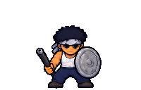 | **Shieldman** | 35 ปกติ | บล็อกดาเมจที่มาจากด้านหน้า และหันตัวช้ากว่าศัตรูทั่วไป | อ้อมไปโจมตีด้านข้างหรือด้านหลัง |
| 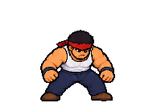 | **Charger** | 40 ปกติ | เดินเข้าหา → เตือน → พุ่งตรง → พักหลังพุ่ง ล็อกทิศเมื่อเริ่มพุ่ง | หลบด้านข้างแล้วสวนช่วงพัก |
| 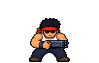 | **Shotgunner** | 45 พิเศษ | รักษาระยะใกล้กว่าสายยิงทั่วไป ยิงกระจายสามทิศทางเป็นพัด | ระวังขอบพัดกระสุน อย่าหลบเข้าทิศยิงข้างเคียง |
|  | **Commander** | 60 พิเศษ | รักษาระยะและบัฟศัตรูรอบตัวทุก 4 วินาที เพิ่มความเร็ว 1.45 เท่าเป็นเวลา 3 วินาที | ให้ความสำคัญกับการกำจัดก่อนฝูงที่ได้รับบัฟ |
| 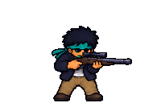 | **Sniper** | 70 พิเศษ | รักษาระยะไกล เตือนเล็ง 1.4 วินาที แล้วยิงนัดเดียวด้วยกระสุนที่เร็วกว่า Shooter | สังเกตแนวเล็งและหลบหรือ Parry ตามจังหวะยิง |
| 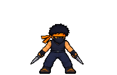 | **Assassin** | 100 พิเศษ | เข้าระยะ → เตือน → พุ่ง → เบรก ช่วงปกติปัดการโจมตีและสะท้อนกระสุนกลับ การพุ่งข้ามการป้องกัน Parry ของผู้เล่น | หลบแนวพุ่ง แล้วโจมตีในช่วงเบรกที่เปิดช่อง 1.2 วินาที |
| 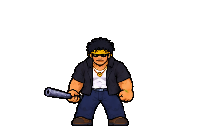 | **Boss** | ทุก 100 ตัว บอส 1v1 | เข้าหาแบบซิกแซก สลับโจมตีประชิด ยิงสองนัด และพุ่งต่อเนื่องสามครั้ง มีเกราะจนจบท่าพิเศษ | รอจบชุดพุ่งแล้วสวนช่วงเกราะเปิด หรือใช้ท่าไม้ตายที่ทะลุเกราะได้ |

### จังหวะโจมตีพื้นฐาน

- Chaser ง้าง 0.48 วินาทีก่อนโจมตี
- Sprinter ง้าง 0.34 วินาที
- Shooter เล็งเตือน 1.5 วินาที และล็อกทิศ 0.16 วินาทีก่อนยิงแต่ละนัด
- Sniper และ Shotgunner มีเวลาเล็งเฉพาะของตัวเอง แต่ใช้ช่วงล็อกทิศจากคลาส Shooter ร่วมกัน

## วงจรบอส

1. เมื่อฆ่าศัตรูที่ไม่ใช่บอสครบ 100 ตัว ระบบนำศัตรูที่เหลือกลับ Pool และหยุดการเกิดตัวอื่น
2. รอ 1.8 วินาที แล้วเรียกบอสเพียงตัวเดียวเพื่อดวล 1v1
3. บอสมีเลือดพื้นฐาน 12 หลังชนะบอสแต่ละครั้ง เลือดของบอสตัวถัดไปเพิ่มตามตัวคูณ `1 + BossesDefeated × 0.25`
4. บอสป้องกันการโจมตีทั่วไปจนกว่าจะจบท่าพุ่งสามครั้ง ช่วงเปิดช่องเป็น **1.7 → 1.3 → 1.0 วินาที** ตามจำนวนบอสที่เคยชนะ
5. ท่าไม้ตายใช้ `TakeSlayerHit()` เพื่อทะลุการป้องกันและทำดาเมจ 6
6. เมื่อบอสตาย กลับสู่ Endless และเริ่มนับอีก 100 ตัว ระบบพยายามเติมศัตรูกลุ่มปกติสูงสุด 10 ตัว โดยยังเคารพเพดานจำนวนในสนาม

HUD นับคะแนนจากการฆ่าบอสด้วย แต่เงื่อนไขเรียกบอสและปลดล็อกประเภทศัตรูใช้ยอดที่ไม่นับบอส

## จุดที่แสดง OOP

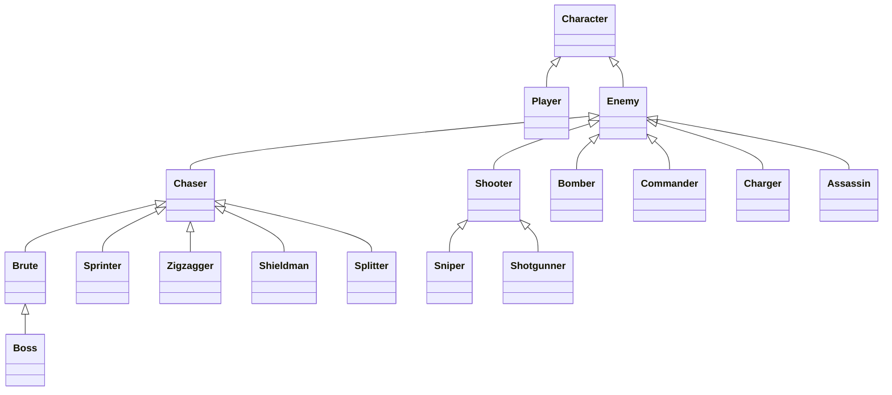

| แนวคิด | ตัวอย่างในเกม |
| --- | --- |
| **Abstraction** | `Enemy` เป็น abstract class และกำหนด `Behave()` ให้คลาสลูกจัดการพฤติกรรมของตนเอง |
| **Inheritance** | `Sprinter` ใช้ระบบประชิดจาก `Chaser`; `Sniper` และ `Shotgunner` ใช้ระบบเล็งยิงจาก `Shooter`; `Boss` สืบทอดจาก `Brute` |
| **Polymorphism** | `Shieldman.TakeDamage()` บล็อกจากด้านหน้า; `Shotgunner.Fire()` เปลี่ยนเป็นยิงกระจาย; `Splitter.Die()` ส่งเหตุการณ์ให้เกิดศัตรูเพิ่ม |
| **Encapsulation** | สถานะการพุ่ง ตัวจับเวลา และตัวแปรภายในซ่อนด้วย `private`; ค่าสำหรับคลาสลูกใช้ `protected`; ภายนอกอ่านสถานะผ่าน properties เช่น `VisualPose` และ `IsOpen` |
| **Interfaces** | `Bomber : IExplosive`, `Commander : IBuffer`, `Assassin : IShootable, IUnparryable` และ `Enemy : IPoolable` แยกความสามารถตามหน้าที่ |
| **Factory / Registry** | `EnemyCatalog` เก็บฟังก์ชันสร้าง ประเภท กลุ่ม เกณฑ์ปลดล็อก และน้ำหนักสุ่ม; `EnemyFactory` ใช้ข้อมูลนี้สร้างตัวละคร |
| **Object Pool** | `Spawner` เก็บ `ObjectPool<Enemy>` แยกตามประเภทและคืนตัวที่เลิกใช้งานกลับ Pool |
| **Events** | `Splitter` แจ้งผ่าน `GameEvents.EnemySplit`; `Spawner` เป็นผู้สร้าง Sprinter สองตัว โดย Splitter ไม่ต้องอ้างอิง Spawner โดยตรง |

### ตัวอย่างการต่อยอด

- เปลี่ยนเฉพาะค่าสถานะ: ดู `Sprinter.Awake()` และ `Sniper.Awake()`
- เพิ่มการเคลื่อนที่: ดู `Zigzagger.Behave()` ซึ่งต่อยอดจากพฤติกรรมคลาสแม่
- เปลี่ยนรูปแบบโจมตี: ดู `Shotgunner.Fire()`
- เพิ่มกฎรับดาเมจ: ดู `Shieldman.TakeDamage()` และ `Boss.TakeDamage()`
- เพิ่มประเภทใหม่: สร้างคลาสลูก เพิ่มค่าใน `EnemyType` และลงทะเบียน `EnemySpec` ใน `EnemyCatalog` พร้อมแอสเซ็ตอนิเมชันของตัวนั้น

## เปิดดูโค้ด

- [Character.cs](Assets/Scripts/Characters/Character.cs) — ชีวิต ดาเมจ และ Knockback ร่วมกัน
- [Enemy.cs](Assets/Scripts/Characters/Enemy.cs) — Enum, วงจรศัตรู, Buff, Pool และพฤติกรรม abstract
- [Enemies](Assets/Scripts/Characters/Enemies) — คลาสศัตรูแต่ละประเภท รวม Assassin และ Boss
- [EnemyCatalog.cs](Assets/Scripts/Characters/EnemyCatalog.cs) — กลุ่ม เกณฑ์ปลดล็อก และน้ำหนักสุ่ม
- [IUnparryable.cs](Assets/Scripts/Characters/IUnparryable.cs) — การโจมตีที่ข้าม Parry
- [Contracts.cs](Assets/Scripts/Core/Contracts.cs) — Interfaces
- [Spawner.cs](Assets/Scripts/Game/Spawner.cs) — การสุ่มเกิด การปลดล็อก และวงจรบอส
- [ObjectPool.cs](Assets/Scripts/Core/ObjectPool.cs) — การนำวัตถุกลับมาใช้
- [EnemyFactory.cs](Assets/Scripts/Game/EnemyFactory.cs) — การสร้างตัวละครจาก Catalog
