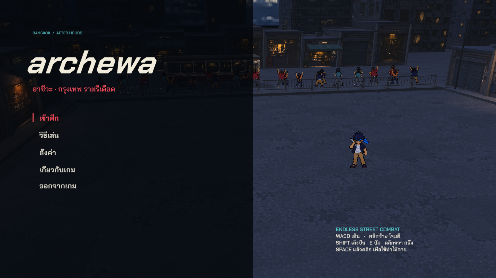
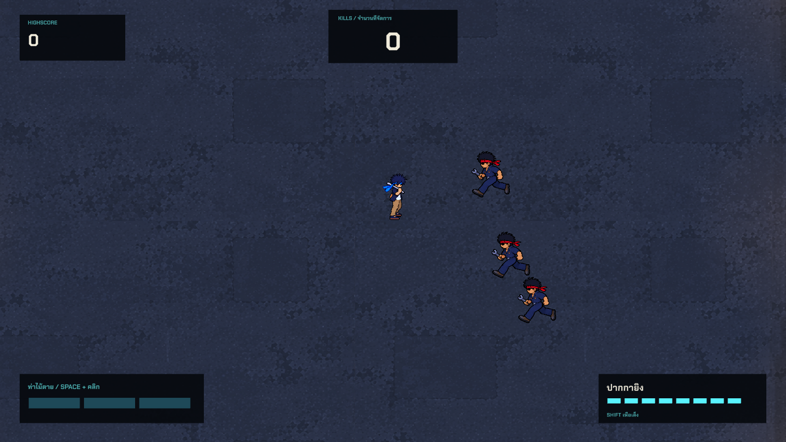
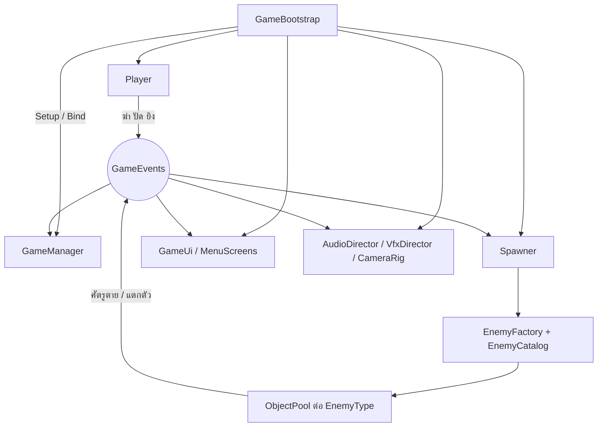

# archewa

**อาชีวะ · กรุงเทพ ราตรีเดือด**

เกมแอ็กชันเอาตัวรอดแบบ Endless ในลานต่อสู้ยามค่ำคืนของกรุงเทพ ตัวละคร Pixel Art อยู่ในฉากสามมิติ เน้นการอ่านจังหวะโจมตี หลบ ปัดกระสุน และสวนกลับ ผู้เล่นโดนโจมตีสำเร็จครั้งเดียวจบเกม



## เกมเพลย์



มุมกล้องเฉียงต่ำช่วยให้เห็นหน้าร้านและความลึกของลานต่อสู้ โดยคุมระยะให้ยังอ่านท่าของศัตรูได้

- ฆ่าศัตรูหนึ่งตัวได้หนึ่งคะแนน พร้อม Highscore และคอมโบที่ต้องรักษาจังหวะ
- ศัตรู **14 ประเภท รวมบอส** มีรูปแบบไล่ประชิด ยิง บัฟ ระเบิด ป้องกัน และพุ่งชน
- ทุก **100 ตัวที่ฆ่าได้โดยไม่นับบอส** จะเคลียร์สนามเพื่อดวลบอสแบบ **1v1**
- ชนะบอสแล้วกลับเข้า Endless ความหนาแน่นศัตรูเพิ่มขึ้น และบอสครั้งต่อไปมีเลือดมากขึ้นกับช่วงเปิดช่องที่สั้นลง
- ปัดการโจมตีและสะท้อนกระสุน ใช้ปืนปากกา หรือสะสมเกจสามส่วนเพื่อใช้ท่าไม้ตาย
- ฉากมีคนมุงเชียร์ รถเมล์ รถไฟฟ้า พัดลม ไอน้ำ แสงร้านค้า และท้องฟ้ากลางคืน

ดูภาพและรายละเอียดแต่ละตัวใน **[คู่มือประเภทศัตรู](ENEMY_TYPES.md)** พร้อมตัวอย่างโครงสร้าง OOP ที่ใช้ในเกม

## การควบคุม

| ปุ่ม | การทำงาน |
| --- | --- |
| W / A / S / D | วิ่ง |
| เมาส์ | เล็งปืนและแนวสกิล |
| คลิกซ้าย | โจมตีระยะประชิด |
| Shift ค้าง + คลิกซ้าย | เล็งและยิงปืนปากกา |
| คลิกขวาขณะเคลื่อนที่ | Dash หลบ |
| E | ยกอาวุธ Parry / สะท้อนกระสุน |
| Space แล้วคลิกซ้าย | เลือกแนวโจมตีและใช้สกิลจากเกจ |
| Space แล้วคลิกขวาเมื่อเกจเต็ม 3 ส่วน | ท่าไม้ตาย จากนั้นคลิกซ้ายเลือกศัตรูให้ฟัน |
| Esc / P | หยุดเกม |
| M | เปิด / ปิดเสียง |
| R | เริ่มเล่นใหม่ |

Dash ใช้เพื่อออกจากแนวโจมตี ต้องเคลื่อนที่และไม่ได้กำลังเล็งปืนอยู่

## เปิดโปรเจกต์

1. ติดตั้ง **Unity 6000.3.24f1** ผ่าน Unity Hub
2. Clone repository:

   ```sh
   git clone https://github.com/nopparoot15/archewa.git
   ```

3. ใน Unity Hub เลือก **Add → Add project from disk** แล้วเลือกโฟลเดอร์ `archewa`
4. รอ Unity นำเข้า Assets และติดตั้ง Packages
5. เปิดฉาก **[Main.unity](Assets/Scenes/Main.unity)** แล้วกด **Play**

ฉากหลักและ UI บันทึกเป็น GameObjects ใน Hierarchy สามารถเปิดดูและจัดวางใน Editor ได้

## โครงสร้างและระบบเกม

โปรเจกต์ใช้ Unity 6000.3.24f1, URP 17.3, C#, Input System, Unity UI และ TextMeshPro ฉากหลักอยู่ที่ `Assets/Scenes/Main.unity` และสคริปต์อยู่ใน `Assets/Scripts`

### สถาปัตยกรรม

`GameBootstrap` ทำงานอัตโนมัติหลังโหลดฉาก หา `MyArcadeRoot` แล้วเชื่อมทุกระบบด้วยมือ (ไม่ใช้ Singleton เป็นหลัก) ระบบต่าง ๆ สื่อสารกันผ่าน `GameEvents` ซึ่งเป็น static event bus จึงไม่ต้องอ้างอิงกันโดยตรง



ลำดับใน `GameBootstrap.Wire()`: `GameManager` → `Player` → `VfxDirector` → `Spawner` → `CameraRig` → `AudioDirector` → `GameUi` → `MenuScreens` จากนั้นเปิด `Player` และ `Spawner` เฉพาะตอนสถานะ `Playing`

การเริ่มใหม่ใช้วิธีโหลดฉากซ้ำ พร้อมล้าง event ทั้งหมด

### สคริปต์แยกตามโฟลเดอร์

| โฟลเดอร์ | ไฟล์ | หน้าที่ |
| --- | --- | --- |
| `Core` | `Contracts` | Interfaces, `Team`, `AttackContext` |
| | `GameEvents` | Event bus ทั้งเกม |
| | `ObjectPool` | Pool แบบ generic |
| | `Util` | ฟังก์ชันช่วย |
| `Game` | `GameBootstrap` | เชื่อมระบบ เริ่มใหม่ กลับหน้าแรก |
| | `GameManager` | สถานะเกม คะแนน คอมโบ Boldness สถิติ |
| | `Spawner` | การเกิดศัตรู ความยาก วงจรบอส |
| | `EnemyFactory` | สร้างศัตรูและกระสุนจาก Prefab ใน `Resources` |
| | `Arena` | ขอบลาน (±17 หน่วย) และจุดเกิด |
| | `SlowMotion` | จัดการ timeScale และ hit freeze |
| | `GameSettings` | ค่าตั้งค่าใน `PlayerPrefs` |
| | `AudioDirector` | เสียงตาม event และเสียงการ์ด |
| `Characters` | `Character` | คลาสแม่: เลือด ดาเมจ Knockback การเคลื่อนที่ |
| | `Player` | การควบคุม ปืน ปัด สแตมินา กระสุน |
| | `Enemy` | คลาสแม่ศัตรู: Pool, Buff, ระยะห่างในฝูง |
| | `Enemies/*` | ศัตรูแต่ละประเภท |
| | `EnemyCatalog` | เกณฑ์ปลดล็อก กลุ่ม น้ำหนักสุ่ม |
| | `SlashSkill` | เกจ ท่าฟัน ท่าไม้ตาย |
| | `Abilities` | `DashAbility`, `ParryAbility` |
| | `PlayerStats` | ตัวปรับค่าผู้เล่น |
| `Weapons` | `Weapon` | `Weapon` → `MeleeWeapon` → `SteelPipe` |
| | `Bullet` | การเคลื่อนที่ ชน สะท้อน นับการหลบ |
| | `BulletSpawner` | สร้างกระสุนผ่าน Pool |
| | `GunAim` | คำนวณจุดเล็งปืน |
| `Input` | `PlayerInput` | รองรับทั้ง Input System ใหม่และระบบเก่า |
| `UI` | `GameUi` | HUD แบนเนอร์ หน้าจบเกม |
| | `MenuScreens` | เมนูหลัก หยุดเกม ตั้งค่า วิธีเล่น เครดิต |
| `Visual` | `CharacterView` และ Animator ต่าง ๆ | เลือกท่า ทิศ และเฟรมสไปรต์ |
| | `CameraRig` | ติดตามผู้เล่น สั่นจอ โหมดหน้าแรก |
| | `VfxDirector`, `SlashArc`, `BulletVisual` | อนุภาค เลือด ศพ วงระเบิด รอยฟัน |
| | `ArchewaSceneLife`, `CrowdSpectator`, `DecorativeTransit` | พัดลม ป้ายไฟ คนมุง รถเมล์ รถไฟฟ้า |
| `Editor` | `SpriteImporter`, `ThaiAlleyDepthImporter`, `TmpEssentials` | ตั้งค่า Import และติดตั้ง TMP อัตโนมัติ |

## ระบบเกม

### สถานะเกม

`Title` → `Playing` ⇄ `Paused` → `GameOver`

`Paused` ตั้ง `timeScale` เป็น 0 และหยุดเวลาเล็งกับจังหวะทำดาเมจของสกิล เมื่อเล่นต่อสกิลจะเดินต่อจากจุดเดิม ส่วนสถานะอื่นใช้ค่าจาก `SlowMotion`

### การต่อสู้ของผู้เล่น

| ระบบ | ค่าในโค้ด |
| --- | --- |
| เลือด | 1 |
| ท่อเหล็ก (`SteelPipe`) | ดาเมจ 3, ระยะ 2.3, มุม 100°, ทุก 0.3 วินาที, ฟันตามทิศเดินล่าสุด โดนตัวที่ใกล้สุดตัวเดียว |
| สแตมินา | ใช้ 7% ต่อการฟัน ต้องมีอย่างน้อย 7% จึงฟันได้ หยุดฟัน 1 วินาทีจึงเริ่มฟื้น ฟื้น 200% ต่อวินาที |
| ปืนปากกา | ดาเมจ 3, กระสุนสูงสุด 8, ทุก 0.2 วินาที, ยืนนิ่งขณะเล็ง |
| การเติมกระสุน | 8 นัดต่อ 30 วินาที และ +0.45 ต่อการฆ่า |
| Dash | 0.125 วินาที อมตะตลอดท่า พัก 0.105 วินาที ต้องกำลังเคลื่อนที่และไม่เล็งปืน |
| Parry | การ์ดนาน 1.5 วินาที ดีเลย์ 0.3 วินาทีหลังจบ การฟันระหว่างการ์ดจะยกเลิกการ์ด |

การรับมือกระสุนมี 3 แบบ:

- **Parry** สะท้อนกลับทางเดิม ดาเมจ 2 สุ่มเบี่ยงไม่เกิน 8°
- **ฟันให้กระสุนเข้าตัว** ภายใน 0.22 วินาทีหลังเริ่มฟัน กระสุนจะพุ่งไปหาศัตรูที่ใกล้สุด ดาเมจ ×100
- **ฟันโดนกระสุนกลางอากาศ** กระสุนไปตามทิศที่ฟัน ดาเมจ 4

### เกจและท่าไม้ตาย (`SlashSkill`)

เกจมี 3 ส่วน ได้ 0.15 ต่อการฆ่าหรือการปัด และได้เพิ่ม 0.0035 ต่อคอมโบ (นับสูงสุด 20) ส่วนที่เต็มแล้วจะคงอยู่ ส่วนที่ยังไม่เต็มลดลง 0.07 ต่อวินาที

| ท่า | วิธีใช้ | ผล |
| --- | --- | --- |
| **ฟันพุ่ง** | Space เข้าโหมดเล็ง แล้วคลิกซ้าย ใช้ 1 ส่วน | พุ่งเป็นเส้นตรง 2.5–13 หน่วย ทำดาเมจในแนว ทำ 6 กับ Brute และ Boss แต่ยังถูกการ์ดของ Shieldman, Assassin และ Boss กันได้ นับเฉพาะตัวที่เสียเลือดจริง |
| **ท่าไม้ตาย** | เกจเต็ม Space แล้วคลิกขวา | ศัตรูหยุดนิ่ง ทุกคลิกเลือกศัตรูบนจอแบบสุ่มหนึ่งตัว แล้วตัวที่เลือกไว้รับผลพร้อมกันเมื่อเกจหมดหรือเลือกครบ ทะลุการป้องกันทุกแบบ ฆ่าศัตรูทั่วไปและ Brute ส่วน Boss เสียเลือด 6 |

โหมดเล็งมีเวลา 4.2 วินาทีจริง เวลาในเกมเหลือ 0.7 เท่า กด Space อีกครั้งเพื่อยกเลิก ท่าไม้ตายทำดาเมจบอส 6 ผ่าน `TakeSlayerHit()` โดยไม่สนการป้องกัน

### คะแนน

- **คะแนน:** +1 ต่อการฆ่าทุกตัว รวมบอส
- **คอมโบ:** ต่อภายใน 1.5 วินาที ทุก 10 คอมโบเกิด Slow Motion
- **Boldness:** หลบกระสุน +30, ปัด +30, ฟันพุ่งทำดาเมจสำเร็จอย่างน้อยหนึ่งตัว +10 ต่อครั้ง, ฆ่า Brute/Assassin/Boss +25, ท่าไม้ตาย +3 ต่อตัว, ยิงโดน +1
- **สถิติ:** Highscore, คอมโบสูงสุด, Boldness สูงสุด เก็บใน `PlayerPrefs` ตอนตาย และหน้าจบเกมแสดงความแม่นยำการฟันของรอบนั้น

การ์ดของศัตรูส่ง `EnemyGuarded` เพื่อเล่นเสียงและเอฟเฟกต์เท่านั้น ไม่ได้เกจหรือ Boldness และไม่ขึ้น `DEFLECTED!` ส่วน `Deflected` ใช้สำหรับการปัดสำเร็จของผู้เล่น

### ศัตรูและการเกิด

จุดเกิดพยายามสุ่มริมสนามนอกกล้องทั้ง Perspective และ Orthographic สูงสุด 16 ครั้ง หากไม่พบยังใช้จุดสุ่มริมสนามที่อาจอยู่ในจอ

ศัตรูแบ่ง 2 กลุ่มที่มีตัวจับเวลาแยกกัน กลุ่มปกติเกิดเพิ่มทุกครั้งที่มีศัตรูตายด้วย น้ำหนักสุ่มเพิ่มทุก 100 ตัวตาม `EnemyCatalog`

| ค่าความยาก | เริ่ม → สุด | เต็มที่ |
| --- | --- | --- |
| รอบเกิดกลุ่มปกติ | 6 → 3.5 วินาที | 150 ตัว |
| เพดานกลุ่มปกติ | 3 → 24 ตัว (+3 ต่อบอสที่ชนะ) | 150 ตัว |
| รอบเกิดกลุ่มพิเศษ | 25 → 8 วินาที | 500 ตัว |
| ตัวคูณความเร็วกลุ่มปกติ | ×0.86 → ×1.5 | 1,500 ตัว |
| เลือด Brute | +15% ทุก 100 ตัว | ไม่จำกัด |

ดูภาพ พฤติกรรม เกณฑ์ปลดล็อก และวิธีรับมือศัตรูทั้ง 14 ประเภทใน **[คู่มือประเภทศัตรู](ENEMY_TYPES.md)**

### วงจรบอส

1. ครบ 100 ตัว ศัตรูที่เหลือกลับ Pool และหยุดการเกิด
2. รอ 1.8 วินาที แล้วเรียกบอส เลือด `12 × (1 + บอสที่ชนะแล้ว × 0.25)`
3. บอสซิกแซกเข้าหา แล้วสุ่มท่า: ประชิด 50%, ยิง 25%, พุ่ง 25% และบังคับใช้ท่าพุ่งหลังโจมตีปกติครบ 2 ครั้ง
4. บอสยิงชุดละ 2 นัด ท่าพิเศษพุ่ง 3 ครั้ง ครั้งละ 0.35 วินาที พักพร้อมท่าเตือนระหว่างครั้ง 0.46 วินาที เมื่อจบท่าพุ่ง การ์ดแตก เปิดช่อง 1.7 → 1.3 → 1.0 วินาทีตามจำนวนบอสที่ชนะ
5. บอสตาย กลับสู่ Endless เรียกศัตรูปกติสูงสุด 10 ตัว และเริ่มนับอีก 100 ตัว

### UI เสียง และภาพ

- **HUD:** คะแนน สถิติ แถบคอมโบ เกจ 3 ส่วน กระสุน เลือดบอส ข้อความ Boldness
- **เมนู:** หน้าแรก หยุดเกม ตั้งค่า วิธีเล่น เครดิต ใช้ได้ทั้งคีย์บอร์ดและเมาส์
- **ตั้งค่า:** ความดัง สั่นจอ เต็มจอ VSync แสดง FPS
- **เสียง:** สุ่มจากไฟล์หลายแบบใน `Resources/Audio` ตามชื่อเสียงที่ event ร้องขอ
- **เอฟเฟกต์:** อนุภาค เลือดสูงสุด 90 จุด ศพสูงสุด 40 ตัว วงเตือนระเบิด แสงระเบิด
- **ฉาก:** กล้อง Perspective เอียง 30° คนมุง รถเมล์ รถไฟฟ้า พัดลม ป้ายไฟ และ Shader สำหรับพื้น ร้านค้า และสไปรต์รับแสง
