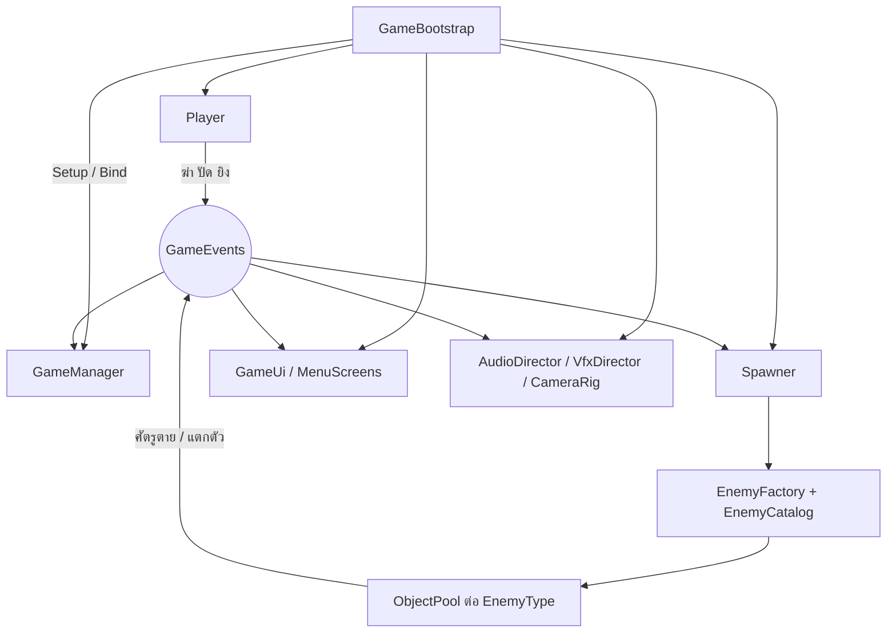

# ระบบและสคริปต์ — archewa

สรุปโครงสร้างโค้ด ระบบเกม และฟีเจอร์ จากสคริปต์ C# ใน `Assets/Scripts` (57 ไฟล์ ประมาณ 6,600 บรรทัด)

[กลับ README](README.md) · [คู่มือประเภทศัตรู](ENEMY_TYPES.md)

**เทคโนโลยี:** Unity 6000.3.24f1, URP 17.3, C#, Input System, Unity UI, TextMeshPro

## ภาพรวม

เกมแอ็กชัน Endless ตัวละคร Pixel Art ในฉากสามมิติ ผู้เล่นมีเลือด 1 หน่วย ถูกโจมตีสำเร็จครั้งเดียวจบเกม ศัตรูทั่วไปตายในครั้งเดียวเช่นกัน ยกเว้น Brute และ Boss ฆ่าศัตรูปกติครบทุก 100 ตัวจะเข้าสู่การดวลบอส 1v1

## สถาปัตยกรรม

`GameBootstrap` ทำงานอัตโนมัติหลังโหลดฉาก หา `MyArcadeRoot` แล้วเชื่อมทุกระบบด้วยมือ (ไม่ใช้ Singleton เป็นหลัก) ระบบต่าง ๆ สื่อสารกันผ่าน `GameEvents` ซึ่งเป็น static event bus จึงไม่ต้องอ้างอิงกันโดยตรง

ลำดับใน `GameBootstrap.Wire()`: `GameManager` → `Player` → `VfxDirector` → `Spawner` → `CameraRig` → `AudioDirector` → `GameUi` → `MenuScreens` จากนั้นเปิด `Player` และ `Spawner` เฉพาะตอนสถานะ `Playing`

การเริ่มใหม่ใช้วิธีโหลดฉากซ้ำ พร้อมล้าง event ทั้งหมด

## สคริปต์แยกตามโฟลเดอร์

| โฟลเดอร์ | ไฟล์ | หน้าที่ |
| --- | --- | --- |
| `Core` | `Contracts` | Interfaces, `Team`, `AttackContext` |
| | `GameEvents` | Event bus ทั้งเกม |
| | `ObjectPool` | Pool แบบ generic |
| | `Util` | ฟังก์ชันช่วย |
| `Game` | `GameBootstrap` | เชื่อมระบบ เริ่มใหม่ กลับหน้าแรก |
| | `GameManager` | สถานะเกม คะแนน คอมโบ Boldness สถิติ |
| | `Spawner` | การเกิดศัตรู ความยาก วงจรบอส |
| | `EnemyFactory` | สร้างศัตรูและกระสุนจาก Prefab ใน `Resources` |
| | `Arena` | ขอบลาน (±17 หน่วย) และจุดเกิด |
| | `SlowMotion` | จัดการ timeScale และ hit freeze |
| | `GameSettings` | ค่าตั้งค่าใน `PlayerPrefs` |
| | `AudioDirector` | เสียงตาม event และเสียงการ์ด |
| `Characters` | `Character` | คลาสแม่: เลือด ดาเมจ Knockback การเคลื่อนที่ |
| | `Player` | การควบคุม ปืน ปัด สแตมินา กระสุน |
| | `Enemy` | คลาสแม่ศัตรู: Pool, Buff, ระยะห่างในฝูง |
| | `Enemies/*` | ศัตรูแต่ละประเภท |
| | `EnemyCatalog` | เกณฑ์ปลดล็อก กลุ่ม น้ำหนักสุ่ม |
| | `SlashSkill` | เกจ ท่าฟัน ท่าไม้ตาย |
| | `Abilities` | `DashAbility`, `ParryAbility` |
| | `PlayerStats` | ตัวปรับค่าผู้เล่น |
| `Weapons` | `Weapon` | `Weapon` → `MeleeWeapon` → `SteelPipe` |
| | `Bullet` | การเคลื่อนที่ ชน สะท้อน นับการหลบ |
| | `BulletSpawner` | สร้างกระสุนผ่าน Pool |
| | `GunAim` | คำนวณจุดเล็งปืน |
| `Input` | `PlayerInput` | รองรับทั้ง Input System ใหม่และระบบเก่า |
| `UI` | `GameUi` | HUD แบนเนอร์ หน้าจบเกม |
| | `MenuScreens` | เมนูหลัก หยุดเกม ตั้งค่า วิธีเล่น เครดิต |
| `Visual` | `CharacterView` และ Animator ต่าง ๆ | เลือกท่า ทิศ และเฟรมสไปรต์ |
| | `CameraRig` | ติดตามผู้เล่น สั่นจอ โหมดหน้าแรก |
| | `VfxDirector`, `SlashArc`, `BulletVisual` | อนุภาค เลือด ศพ วงระเบิด รอยฟัน |
| | `ArchewaSceneLife`, `CrowdSpectator`, `DecorativeTransit` | พัดลม ป้ายไฟ คนมุง รถเมล์ รถไฟฟ้า |
| `Editor` | `SpriteImporter`, `ThaiAlleyDepthImporter`, `TmpEssentials` | ตั้งค่า Import และติดตั้ง TMP อัตโนมัติ |

## ระบบเกม

### สถานะเกม

`Title` → `Playing` ⇄ `Paused` → `GameOver`

`Paused` ตั้ง `timeScale` เป็น 0 ส่วนสถานะอื่นใช้ค่าจาก `SlowMotion`

### การต่อสู้ของผู้เล่น

| ระบบ | ค่าในโค้ด |
| --- | --- |
| เลือด | 1 |
| ท่อเหล็ก (`SteelPipe`) | ดาเมจ 3, ระยะ 2.3, มุม 100°, ทุก 0.3 วินาที, โดนตัวที่ใกล้สุดตัวเดียว |
| สแตมินา | ใช้ 7% ต่อการฟัน หยุดฟัน 1 วินาทีจึงเริ่มฟื้น ฟื้น 200% ต่อวินาที |
| ปืนปากกา | ดาเมจ 3, กระสุนสูงสุด 8, ทุก 0.2 วินาที, ยืนนิ่งขณะเล็ง |
| การเติมกระสุน | 8 นัดต่อ 30 วินาที และ +0.45 ต่อการฆ่า |
| Dash | 0.125 วินาที อมตะตลอดท่า พัก 0.105 วินาที ต้องกำลังเคลื่อนที่และไม่เล็งปืน |
| Parry | การ์ดนาน 1.5 วินาที ดีเลย์ 0.3 วินาทีหลังจบ การฟันระหว่างการ์ดจะยกเลิกการ์ด |

การรับมือกระสุนมี 3 แบบ:

- **Parry** สะท้อนกลับทางเดิม ดาเมจ 2 สุ่มเบี่ยงไม่เกิน 8°
- **ฟันให้กระสุนเข้าตัว** ภายใน 0.22 วินาทีหลังเริ่มฟัน กระสุนจะพุ่งไปหาศัตรูที่ใกล้สุด ดาเมจ ×100
- **ฟันโดนกระสุนกลางอากาศ** กระสุนไปตามทิศที่ฟัน ดาเมจ 4

### เกจและท่าไม้ตาย (`SlashSkill`)

เกจมี 3 ส่วน ได้ 0.15 ต่อการฆ่าหรือการปัด และได้เพิ่ม 0.0035 ต่อคอมโบ (นับสูงสุด 20) ส่วนที่เต็มแล้วจะคงอยู่ ส่วนที่ยังไม่เต็มลดลง 0.07 ต่อวินาที

| ท่า | วิธีใช้ | ผล |
| --- | --- | --- |
| **ฟันพุ่ง** | Space เข้าโหมดเล็ง แล้วคลิกซ้าย ใช้ 1 ส่วน | พุ่งเป็นเส้นตรง 2.5–13 หน่วย ฆ่าทุกตัวในแนว ทำ 6 กับ Brute และ Boss |
| **ท่าไม้ตาย** | เกจเต็ม Space แล้วคลิกขวา | ศัตรูหยุดนิ่ง ทุกคลิกเลือกศัตรูบนจอแบบสุ่มหนึ่งตัว แล้วทุกตัวรับผลพร้อมกันตอนเกจหมด |

โหมดเล็งมีเวลา 4.2 วินาทีจริง เวลาในเกมเหลือ 0.7 เท่า กด Space อีกครั้งเพื่อยกเลิก ท่าไม้ตายทำดาเมจบอส 6 ผ่าน `TakeSlayerHit()` โดยไม่สนการป้องกัน

### คะแนน

- **คะแนน:** +1 ต่อการฆ่าทุกตัว รวมบอส
- **คอมโบ:** ต่อภายใน 1.5 วินาที ทุก 10 คอมโบเกิด Slow Motion
- **Boldness:** หลบกระสุน +30, ปัด +30, ฟันพุ่งโดน +10, ฆ่า Brute/Assassin/Boss +25, ท่าไม้ตาย +3 ต่อตัว, ยิงโดน +1
- **สถิติ:** Highscore, คอมโบสูงสุด, Boldness สูงสุด เก็บใน `PlayerPrefs` ตอนตาย และหน้าจบเกมแสดงความแม่นยำการฟันของรอบนั้น

### ศัตรูและการเกิด

ศัตรูแบ่ง 2 กลุ่มที่มีตัวจับเวลาแยกกัน กลุ่มปกติเกิดเพิ่มทุกครั้งที่มีศัตรูตายด้วย น้ำหนักสุ่มเพิ่มทุก 100 ตัวตาม `EnemyCatalog`

| ค่าความยาก | เริ่ม → สุด | เต็มที่ |
| --- | --- | --- |
| รอบเกิดกลุ่มปกติ | 6 → 3.5 วินาที | 150 ตัว |
| เพดานกลุ่มปกติ | 3 → 24 ตัว (+3 ต่อบอสที่ชนะ) | 150 ตัว |
| รอบเกิดกลุ่มพิเศษ | 25 → 8 วินาที | 500 ตัว |
| ตัวคูณความเร็วกลุ่มปกติ | ×0.86 → ×1.5 | 1,500 ตัว |
| เลือด Brute | +15% ทุก 100 ตัว | ไม่จำกัด |

| คลาส | ชื่อในเกม | ปลดล็อก | กลุ่ม | จุดเด่น |
| --- | --- | --- | --- | --- |
| `Chaser` | MECHANIC | 0 | ปกติ | ง้าง 0.48 วินาที ใช้คิวโจมตีร่วมกัน |
| `Shooter` | ELECTRICIAN | 0 | พิเศษ | เล็ง 1.5 วินาที ยิงชุดละ 2 นัด |
| `Sprinter` | STREET RACER | 8 | ปกติ | เร็ว ง้างสั้น |
| `Zigzagger` | SWAGGERING THUG | 15 | ปกติ | ส่ายซ้ายขวา |
| `Bomber` | FIRECRACKER KID | 20 | ปกติ | ชนวน 0.85 วินาที รัศมี 3.4 |
| `Splitter` | GANG SWARM | 25 | ปกติ | ตายแล้วแตกเป็น Sprinter 2 ตัว |
| `Brute` | FINAL-YEAR SENIOR | 30 | พิเศษ | เลือด 15 มีท่าจับ |
| `Shieldman` | SHIELD MECHANIC | 35 | ปกติ | กันด้านหน้า หันช้า |
| `Charger` | RAGING BULL | 40 | ปกติ | เตือน พุ่ง แล้วพัก |
| `Shotgunner` | SHORT-GUN MECHANIC | 45 | พิเศษ | ยิงพัด 3 ทิศ |
| `Commander` | RINGLEADER | 60 | พิเศษ | บัฟความเร็ว ×1.45 ทุก 4 วินาที รัศมี 9 |
| `Sniper` | ABANDONED-BUILDING SNIPER | 70 | พิเศษ | เล็ง 1.4 วินาที กระสุนเร็ว |
| `Assassin` | ASSASSIN | 100 | พิเศษ | ป้องกันทุกอย่างยกเว้นช่วงเบรกหลังพุ่ง การพุ่ง Parry ไม่ได้ |
| `Boss` | GANG LEADER | ทุก 100 ตัว | บอส | ดูหัวข้อถัดไป |

### วงจรบอส

1. ครบ 100 ตัว ศัตรูที่เหลือกลับ Pool และหยุดการเกิด
2. รอ 1.8 วินาที แล้วเรียกบอส เลือด `12 × (1 + บอสที่ชนะแล้ว × 0.25)`
3. บอสซิกแซกเข้าหา แล้วสุ่มท่า: ประชิด 50%, ยิง 25%, พุ่ง 25% และบังคับใช้ท่าพุ่งหลังโจมตีปกติครบ 2 ครั้ง
4. จบท่าพุ่ง การ์ดแตก เปิดช่อง 1.7 → 1.3 → 1.0 วินาทีตามจำนวนบอสที่ชนะ
5. บอสตาย กลับสู่ Endless เรียกศัตรูปกติสูงสุด 10 ตัว และเริ่มนับอีก 100 ตัว

### UI เสียง และภาพ

- **HUD:** คะแนน สถิติ แถบคอมโบ เกจ 3 ส่วน กระสุน เลือดบอส ข้อความ Boldness
- **เมนู:** หน้าแรก หยุดเกม ตั้งค่า วิธีเล่น เครดิต ใช้ได้ทั้งคีย์บอร์ดและเมาส์
- **ตั้งค่า:** ความดัง สั่นจอ เต็มจอ VSync แสดง FPS
- **เสียง:** สุ่มจากไฟล์หลายแบบใน `Resources/Audio` ตามชื่อเสียงที่ event ร้องขอ
- **เอฟเฟกต์:** อนุภาค เลือดสูงสุด 90 จุด ศพสูงสุด 40 ตัว วงเตือนระเบิด แสงระเบิด
- **ฉาก:** กล้อง Perspective เอียง 30° คนมุง รถเมล์ รถไฟฟ้า พัดลม ป้ายไฟ และ Shader สำหรับพื้น ร้านค้า และสไปรต์รับแสง

## การต่อยอด

**เพิ่มศัตรู:** สร้างคลาสลูก → เพิ่มค่าใน `EnemyType` → ลงทะเบียน `EnemySpec` ใน `EnemyCatalog` → สร้าง Prefab ที่ `Assets/Resources/Enemies/<ชื่อ type>.prefab` พร้อมแอสเซ็ตอนิเมชัน

**เพิ่มอาวุธ:** สืบทอด `MeleeWeapon` หรือ `Weapon` แล้วใส่ในอาร์เรย์ `weapons` ของ `GameBootstrap.Wire()`

**เพิ่มอัปเกรด:** ปรับค่าใน `PlayerStats` โค้ดผู้เล่นและอาวุธอ่านค่าเหล่านี้อยู่แล้ว

## จุดที่ควรตรวจ

จากการอ่านโค้ด ยังไม่ได้ทดสอบใน Unity

### น่าจะเป็นบั๊ก

- **บอสพุ่งแค่ครั้งเดียว:** `Boss.UpdateCharge()` เพิ่ม `chargesDone` ทุกเฟรมระหว่างช่วงพัก จึงครบ 3 ภายในไม่กี่เฟรมหลังพุ่งครั้งแรก ก่อนถึงเวลาพุ่งครั้งถัดไป
- **ฟันบอสที่กำลังการ์ดได้เกจและ Boldness:** `Boss.TakeDamage()` และ `Assassin.TakeDamage()` ส่ง `Deflected` ตอนป้องกันได้ ทำให้ `GameManager` ให้ +30 และ `SlashSkill` ให้เกจ เหมือนผู้เล่นเป็นคนปัด
- **ฟันพุ่งและท่าไม้ตายอาจไม่ฆ่าบางตัว:** `Assassin` ที่ไม่ได้อยู่ช่วงเบรกจะกันดาเมจไว้ และ `Shieldman` จะกันเมื่อผู้เล่นอยู่ด้านหน้า แต่ `UltimateKilled` ยังนับทุกตัวที่ถูกเลือก
- **จุดเกิดไม่ได้ซ่อนจากกล้อง:** `Arena.RandomHiddenEdgePoint()` คืนค่าทันทีเมื่อกล้องเป็น Perspective ซึ่งเป็นกล้องที่เกมใช้อยู่

### โค้ดกับเอกสารไม่ตรงกัน

- **ทิศฟันท่อ:** README บอกว่าเมาส์เล็งทิศทาง แต่ `Player.AttackDirection()` ใช้ทิศ WASD ล่าสุด เมาส์มีผลกับปืนและท่าฟันพุ่งเท่านั้น
- **ปุ่ม 1 / 2 / 3:** ยังไม่มีผล เพราะ `GameBootstrap` ใส่อาวุธไว้ชนิดเดียวคือ `SteelPipe`
- **บอสยิง:** `ENEMY_TYPES.md` บอกว่ายิง 3 นัด แต่ `ShotsPerAttack = 2`
- **ท่าไม้ตาย:** README ยังไม่ได้เขียนปุ่มคลิกขวาในโหมดเล็ง
- **ลิงก์เสีย:** `ENEMY_TYPES.md` ลิงก์ไป `EnemyTypes.cs`, `EnemyKinds.cs`, `SpecialEnemies.cs` ซึ่งไม่มีแล้ว ปัจจุบันแยกอยู่ใน `Characters/Enemies/` และ `EnemyCatalog.cs`

### โค้ดที่ยังไม่ได้ใช้เต็มที่

- `PlayerStats` ยังไม่มีระบบใดเปลี่ยนค่า จึงอยู่ที่ค่าเริ่มต้นตลอด
- `Spawner.alive` ถูกอัปเดตแต่ไม่มีที่อ่าน
- ค่า `HitInvulnerability` และการตัดคอมโบเมื่อโดนตีแทบไม่มีผล เพราะผู้เล่นตายในครั้งเดียว
